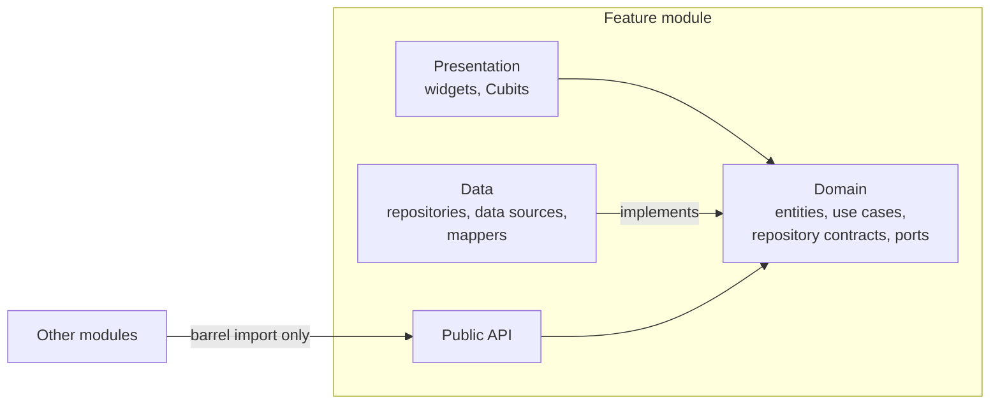

# Stepstones

A meditation timer and chanting app built with Flutter, developed pro bono.

<!-- TODO: one or two sentences on who the project is for (pro bono context). -->

Stepstones records sitting and chanting sessions, shows insights into a practice over time, and has an opt-in presence feature for people practicing nearby. The repository is also meant as a reference for building a Flutter app that stays maintainable as it grows: a modular monorepo, Clean Architecture boundaries that are checked by tooling, and custom rendering with fragment shaders.


<!-- TODO: replace the placeholders below with screenshots or GIFs stored in docs/assets/. -->

| Timer | Parchment background | Particle effects | Stats |
|---|---|---|---|
| _screenshot placeholder_ | _GIF placeholder_ | _GIF placeholder_ | _screenshot placeholder_ |

## Contents

- [Features](#features)
- [Engineering highlights](#engineering-highlights)
- [Graphics and custom widgets](#graphics-and-custom-widgets)
- [Companion packages](#companion-packages)
- [Architecture](#architecture)
- [Backend](#backend)
- [Tech stack](#tech-stack)
- [Quality and testing](#quality-and-testing)
- [Repository layout](#repository-layout)
- [Getting started](#getting-started)
- [AI-assisted development](#ai-assisted-development)
- [Status](#status)
- [License](#license)

## Features

### Chanting player

A karaoke-style player for chants, with lyrics that follow the audio word by word.

<!-- TODO: GIF of the lyrics view during playback. -->

- **Timed lyrics.** Lyrics are authored as ASS/SSA subtitle files and parsed by [`assa_parser`](https://github.com/dropout/assa_parser), a parser written for this project. Each word changes colour as it is sung.
- **Worm scroll.** When the active line changes, the list jumps to its new offset and each line catches up with a staggered paint-time transform, so the lyrics move like a worm instead of a rigid block. The lines are not rebuilt during the animation.
- **Custom sliver.** The stock varied-extent sliver culls children by layout position, which made lines vanish mid-animation. [`UnculledSliverVariedExtentList`](packages/modules/practice/chanting/lib/src/presentation/view/player/unculled_varied_extent_list.dart) paints every built child and lets the viewport clip.
- **Scroll to seek.** Scrolling the lyrics by hand pauses playback and seeks the audio to the line under the anchor. Auto-follow resumes after an idle delay.
- **Playlist.** Chants are queued in a playlist that can be edited before a session and browsed during it.
- **Offline playback.** Audio and lyrics are downloaded from Firebase Storage and cached locally. Drift tracks versions, hashes and download state so stale or damaged files are fetched again.
- **Lock screen controls** through the OS media session.

### Meditation timer

A timer that is meant to be unremarkable in the best sense: it does what it is set to do, with the screen locked or the app in the background.

- **Settings.** Warm-up, duration, interval bells, and separate sounds for the start, the intervals and the end.
- **Background and lock screen.** The timer runs inside an audio handler that keeps the OS media session open, so bells play on time when the screen is locked.
- **Settings history instead of presets.** Every configuration that was used is remembered with its use count and last use. Most people rotate between two or three setups, so they pick from what they already did and never have to name or manage a preset.
- **Volume warning.** An indicator appears when the device volume is too low to hear the bells.

### Presence

An opt-in indicator shown after a session: other people who practiced nearby and around the same time, so the user can see they are not practicing alone.

- Location is a city chosen in the profile, not a device position. The city picker is backed by a [Places search function](#city-search).
- Queries are limited by a time window and a distance range, using a geohash prefix and a latitude and longitude bounding box in Firestore.

### On-device profile image screening

Profile pictures are visible to other people through presence, so each picked image is checked for adult content before it is accepted.

- **Runs on the device.** A TensorFlow Lite image classifier runs through `flutter_litert`. The image is never sent to a server for moderation.
- **Scoring.** The image is resized to 224×224, classified into five categories, and rejected when the combined score of the explicit categories passes a threshold.
- **Scoped lifetime.** The interpreter is created when the image picker opens and disposed with it, so the model does not hold memory for the rest of the session.
- **Replaceable.** The picker depends on a [`SafeImageDetector`](packages/core/lib/src/service/safe_image_detector.dart) interface, with the model behind it.

### Stats and milestones

- **Session log.** Every session is recorded with its type, start, end and duration.
- **Aggregates.** Minutes and session counts are kept in day, week, month and year buckets, which back the bar chart views.
- **Streaks and milestones.** Consecutive days are tracked, and milestones mark progress toward a target number of practice days. These are the stepping stones the app is named after.
- **Health sync.** Completed sessions can be written as mindful minutes to Apple Health and Health Connect.

## Engineering highlights

- **Modular monorepo.** A Melos-managed Dart workspace with two apps and sixteen packages. Each feature is its own package with its own dependencies, localizations and tests.
- **Pragmatic Clean Architecture.** Three layers per module, with the dependency rule pointing at the domain. Cross-module access goes through a deliberate public API or a domain port. See [Architecture](#architecture).
- **Boundaries checked by tooling.** A [boundary check script](support/maintenance_scripts/check_module_boundaries.sh) and a [custom analyzer plugin](packages/stepstones_lints) flag imports that break domain isolation or reach into another module's internals.
- **Custom rendering.** Procedural GLSL fragment shaders, including a scroll-aware parchment background, and a reusable particle system with an experimental Flutter GPU renderer. See [Graphics and custom widgets](#graphics-and-custom-widgets).
- **Reusable widget packages.** [`particle_field`](packages/particle_field) and [`bar_chart`](packages/bar_chart) have no dependency on the app and ship with their own examples.
- **Native Flutter plugins.** Two iOS and Android plugins were written for the app in Swift and Kotlin, with type-safe Pigeon channels: a volume listener that stays accurate after backgrounding, and a mindful minutes sync for Apple Health and Health Connect. See [Companion packages](#companion-packages).
- **Tests at several levels.** Around 125 test files across unit, Cubit and widget tests, plus journey-based integration tests that run against the Firebase emulator.
- **Component catalogue.** A [Widgetbook app](apps/widgetbook) renders shared and feature widgets in isolation.
- **Structured AI workflow.** Provider-neutral skills, prompts and agent roles in [`ai/`](ai), with guardrails that keep agents inside module boundaries.

## Graphics and custom widgets

### Scroll-aware parchment background

Most screens sit on a paper texture that is generated on the GPU and moves with the content, so it reads as one long sheet instead of a fixed wallpaper.

<!-- TODO: GIF of the parchment background scrolling. -->

- **Procedural texture.** [`parchment_noise.frag`](packages/assets/shaders/parchment_noise.frag) layers Worley (cellular) noise, two octaves of fractional Brownian motion for sparse stains, and high-frequency grain. No image assets are involved.
- **Scroll coupling.** [`ParchmentBackground`](packages/core/lib/src/presentation/view/parchment_background.dart) takes a `ValueListenable<double>` scroll offset and passes it to the shader as a uniform. The shader samples the pattern at the content position, so the texture scrolls with the list at no layout cost.
- **Cheap to draw.** The shader renders at a quarter of the screen resolution and is scaled up. It converts back to display pixels internally, so the pattern keeps its size. A `RepaintBoundary` and a tight `shouldRepaint` keep repaints local.
- **Deterministic variation.** A seed uniform offsets the pattern per screen and per day without affecting scrolling.
- **Fallback.** `ShaderRenderingScope` lets a subtree turn shaders off, for example in tests, and the widget falls back to a flat paper colour.

```glsl
// Map the downscaled surface back to display pixels, then follow the content.
vec2 contentPixel = FlutterFragCoord().xy * u_display_size / u_size;
contentPixel.y += u_scroll_offset;
vec2 uv = contentPixel / u_display_size;
```

### Particle field

[`particle_field`](packages/particle_field) is a standalone particle system. The simulation is pure Dart on typed arrays (structure of arrays) and is testable without a widget tree.

<!-- TODO: GIF of the milestone burst and the login background. -->

- Emitters, forces (gravity, drag, attractors, vortices, vector fields) and behaviours over a particle's life.
- Batched rendering through `drawRawAtlas` and `drawRawPoints`, with a 3D camera variant.
- An experimental [Flutter GPU renderer](packages/particle_field/lib/src/gpu/gpu_particle_renderer.dart) that draws all particles as instanced quads in one draw call, using its own vertex and fragment shader bundle. It falls back to the atlas renderer when Flutter GPU is unavailable.
- Used in the app for the login background grid and the milestone celebration burst.

### Other shaders

| Shader | Used for |
|---|---|
| [`linear_gradient_mask.frag`](packages/assets/shaders/linear_gradient_mask.frag) | Progress-driven mask for route transitions into timer, chanting and session screens |
| [`exponential_gradient.frag`](packages/assets/shaders/exponential_gradient.frag) | Vertical gradient whose blend factor follows `t^exponent`, for a softer falloff than a linear gradient |
| [`gradient_flow.frag`](packages/assets/shaders/gradient_flow.frag) | Animated colour flow on the session start button (adapted from Shadertoy, see the file header for attribution) |

Shaders are preloaded during app initialization through a [`ShaderService`](packages/core/lib/src/service/shader_service.dart) interface, so widgets get them synchronously and tests can substitute them.

### Bar chart

[`bar_chart`](packages/bar_chart) is a custom-painted chart package with selectable bars and an info header. It backs the day, week, month and year views in the stats module.

<!-- TODO: screenshot of the stats bar chart. -->

## Companion packages

Three packages were written for Stepstones and live in their own repositories:

| Package | Purpose |
|---|---|
| [`flutter_volume_listener`](https://github.com/dropout/flutter_volume_listener) | Reports device volume changes reliably, including after the app returns from the background, where other plugins reported stale values |
| [`flutter_mindful_minutes`](https://github.com/dropout/flutter_mindful_minutes) | Writes mindful minutes to Apple Health on iOS and Health Connect on Android |
| [`assa_parser`](https://github.com/dropout/assa_parser) | Parses ASS/SSA subtitle files into timed lines and words for the lyrics view |

## Architecture

Stepstones uses Clean Architecture, compressed to three layers per feature module. The dependency rule is kept: presentation and data both depend on the domain, and the domain depends on neither.



What "compressed" means here:

- **Three layers instead of four rings.** Interface adapters and frameworks are folded into presentation and data.
- **Use cases are optional.** They exist where there is a business rule or orchestration, and are skipped where they would only forward a call.
- **The domain stays pure.** No Flutter UI, Firebase, Drift, routing or DI imports. `freezed` annotations and `flutter/foundation` are tolerated.
- **Modules talk through contracts.** A module exposes a public API from its barrel file. Its `src/` is private. A domain that needs another module's capability declares a port.
- **One composition root.** [`apps/mobile_app`](apps/mobile_app/lib/bootstrap) registers each module's dependencies and combines their routes.

Further reading:

- [Architecture overview](docs/architecture_overview.md)
- [Module development guidelines](docs/module_development_guidelines.md)
- [Module dependency guidelines](docs/module_dependency_guidelines.md)

## Backend

The Firebase backend lives in [`support/firebase`](support/firebase), one folder per flavor, with Firestore and Storage rules, indexes, the Remote Config template and Cloud Functions in TypeScript.

### File-based function registration

Functions are not listed by hand. [`index.ts`](support/firebase/staging/functions/src/index.ts) scans the source tree for files ending in `.f.ts` and exports each one under a name built from its path:

```
src/
  auth/
    beforeusercreated.f.ts   ->  auth.beforeusercreated
  call/
    citysearch.f.ts          ->  call.citysearch
    getcitylocation.f.ts     ->  call.getcitylocation
  util/                      Shared helpers, never exported
  models.ts
```

- **One function per file.** The file's default export is the handler, and the directory is its group.
- **The tree is the overview.** Folders mirror the trigger type or the Firestore path, so the deployed function list can be read from the file explorer.
- **Adding a function is adding a file.** `index.ts` does not change, and helpers without the `.f` suffix stay private.

### City search

Presence needs a location, and the app asks for a city instead of a device position. Two callable functions back the city picker with the Google Maps Places API: one returns autocomplete suggestions, the other resolves a chosen place to coordinates.

## Tech stack

| Area | Choice |
|---|---|
| Language and framework | Dart 3, Flutter 3 |
| Workspace | Dart pub workspaces with Melos |
| State management | `flutter_bloc` (Cubit first), `hydrated_bloc` |
| Dependency injection | `get_it` |
| Navigation | `go_router` |
| Models | `freezed` |
| Backend | Firebase Auth, Firestore, Storage, Remote Config, Analytics, Crashlytics |
| Server code | Cloud Functions in TypeScript, Google Maps Places API |
| Local persistence | Drift |
| Audio | `flutter_soloud`, `audio_service`, `audio_session` |
| On-device ML | `flutter_litert` (TensorFlow Lite) |
| Localization | Flutter gen-l10n per package, English and Hungarian |

## Quality and testing

- **Unit and widget tests** live next to each package and run with `melos run test`.
- **Integration tests** in [`apps/mobile_app/integration_test`](apps/mobile_app/integration_test) are written as user journeys on top of robot classes, and run against the Firebase emulator.
- **Static analysis** runs across the workspace with `melos run analyze`.
- **Boundary checks** run with `bash support/maintenance_scripts/check_module_boundaries.sh`. The script covers domain isolation, cross-package `src/` imports, data-to-presentation imports, entity leaks through the public API and barrel exports. It currently passes with no violations.
- **CI** is not set up yet. All checks run locally.

## Repository layout

```
apps/
  mobile_app/          App shell, flavor entry points, bootstrap, integration tests
  widgetbook/          Component catalogue
packages/
  core/                Shared services, DI, design system widgets
  assets/              Fonts, images, sounds, haptics, shaders
  firebase_provider/   Firebase SDK access and emulator configuration
  modules/             Feature modules: auth, home, profile, session, social,
                       stats, donate, practice/timer, practice/chanting
  particle_field/      Particle system package
  bar_chart/           Bar chart package
  stepstones_lints/    Analyzer plugin for module boundary rules
docs/                  Architecture and module guidelines
ai/                    Skills, prompts and agent roles
support/               Firebase backend sources and maintenance scripts
```

## Getting started

The app needs Firebase configuration files per flavor, which are not in the repository:

- iOS: `apps/mobile_app/ios/config/<flavor>/GoogleService-Info.plist`
- Android: `apps/mobile_app/android/app/src/<flavor>/google-services.json`

Set up the workspace:

```bash
flutter doctor
melos bootstrap
melos run codegen
melos run codegen:l10n
melos run analyze
melos run test
```

Run the app from `apps/mobile_app`:

```bash
flutter run --flavor <flavor> -t lib/main_<flavor>.dart
```

The development and test entry points use the Firebase emulator. See [docs/commands.md](docs/commands.md) for flavors, builds and distribution.

## AI-assisted development

AI tooling is treated as part of the codebase and kept provider-neutral in [`ai/`](ai):

- **Skills** describe repeatable workflows such as scaffolding a module, writing a data layer, wiring a shader asset and verifying a package.
- **Agent roles** are split by function: architect, module implementer, test writer and reviewer.
- **Guardrails** in [AGENTS.md](AGENTS.md) limit an agent to one package at a time, route cross-package changes through contracts, and require verification and review before a change counts as done.

## Status

Version 0.11.12, in active development and distributed to testers through Firebase App Distribution. Not yet published to the App Store or Google Play.

## License

The source code is licensed under the [GNU General Public License v3.0](LICENSE).

Third-party material keeps its own terms and is not covered by the GPL:

- [`gradient_flow.frag`](packages/assets/shaders/gradient_flow.frag) is adapted from Shadertoy and includes code under CC BY-NC-SA 3.0, as noted in the file header.
- Fonts in [`packages/assets/fonts`](packages/assets/fonts) are distributed under their own licenses.
- The image classification model in [`packages/assets`](packages/assets) is GantMan's NSFW model and is distributed under its own license.

## Author

<!-- TODO: your name as you want it shown. -->

[GitHub](https://github.com/dropout)
