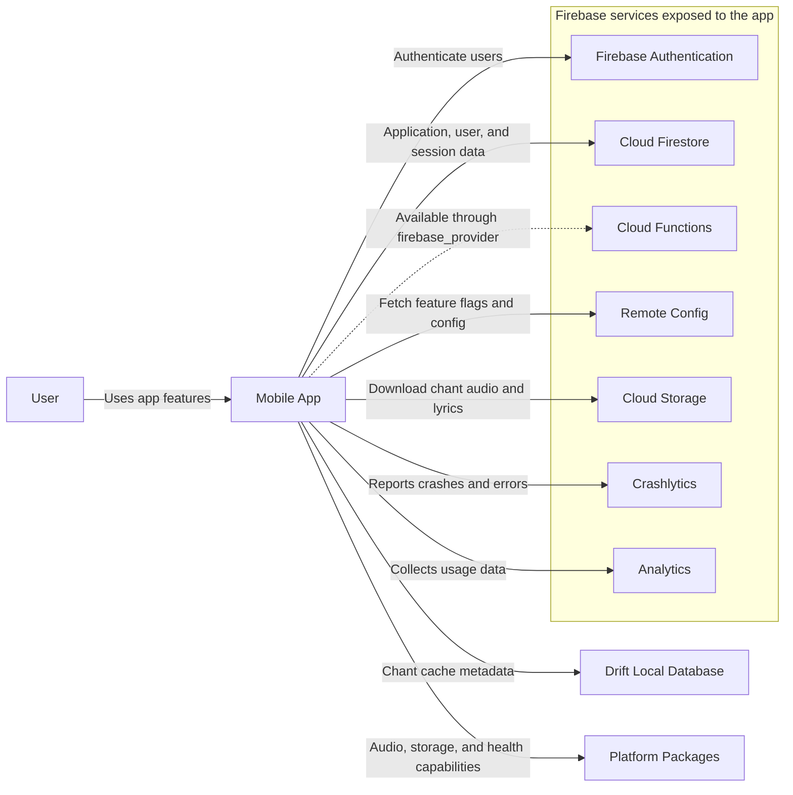
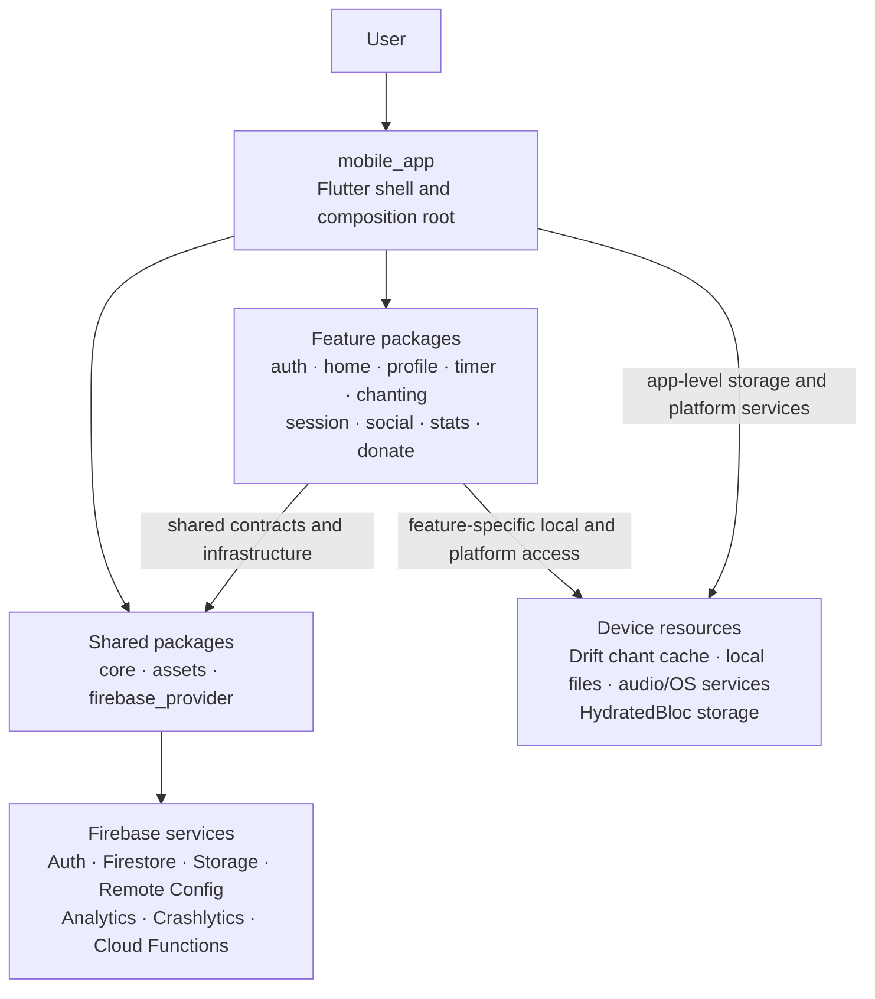
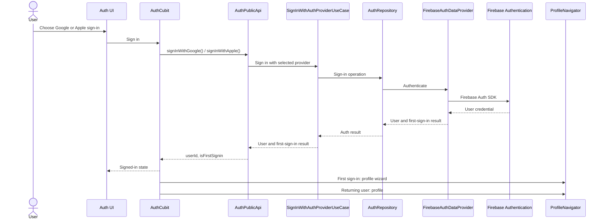
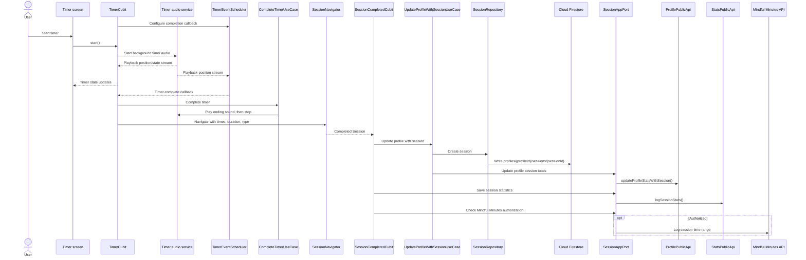
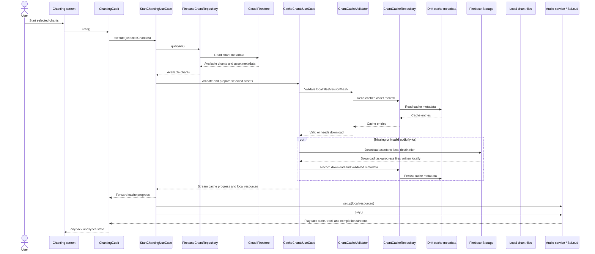

# Architectural Overview Document

## 1. Context
Stepstones is a Flutter mobile app for sitting and chanting meditation. It records practice sessions, provides practice insights, and includes an opt-in social presence feature for users practicing nearby.

### TL;DR
- Built using Flutter and Firebase
- Uses feature modules with Clean Architecture principles

### 1.1 Application Purpose
The app supports sitting and chanting meditation, records completed sessions, and presents insights into a user's practice. When enabled in the user's profile, social presence can show other users practicing nearby.

### 1.2 Technical Goals

#### Pragmatic simplicity
Use feature boundaries and layer contracts where they improve cohesion and testability, without adding pass-through abstractions to simple flows.

#### Cross-Platform Development
The application is built using Flutter, which allows for cross-platform development.

#### Modular Architecture
Feature packages own their presentation, domain contracts, and data implementations. Cross-module interactions use public APIs or explicit domain contracts; `core` provides shared infrastructure and utilities. The mobile app is the composition root.

#### Dependency Injection
The app and feature packages register dependencies through GetIt. The app initializer registers shared services and module dependencies before creating the root widget.

#### Backend
Firebase SDKs provide authentication, Firestore data access, Storage downloads, Remote Config, Analytics, and Crashlytics. The `firebase_provider` package centralizes access to the Firebase SDKs used by the app.

#### Environment Flavors
The mobile app has separate entry points for development, test, staging, and production. Development and test initialize the Firebase emulator; staging and production initialize their configured Firebase projects. Each flavor requires its platform-specific Firebase configuration.

### 1.3 Target Audience
This document is intended for developers who are working on the Stepstones application. It provides an overview of the architecture, design principles, and module structure. It helps onboarding new developers and maintain consistency across the codebase.

### 1.4 System Context Diagram

## 2. Architecture & Patterns
The app uses feature-first Flutter packages with a pragmatic three-layer structure. A package may omit layers or use cases that do not add value to its feature.

### 2.1. Layer Responsibilities

- **Presentation:** Flutter screens and widgets render state and dispatch user actions. Cubits/Blocs coordinate screen flows and expose immutable state.
- **Domain:** Feature entities, repository/service contracts, and use cases for meaningful business rules or orchestration.
- **Data:** Firebase and local data providers, repository implementations, platform integrations, and mapping between external data and domain models.
- **Public API:** Feature packages expose deliberate APIs for cross-package use. Internal `src/` implementation files are not cross-module contracts.

Within a module, presentation depends on domain contracts and data implements domain contracts. Cross-feature dependencies use published public contracts, with ports where domain orchestration needs an external capability; modules do not import another package's internal `src/` files. See the [module dependency guidelines](./module_dependency_guidelines.md) for detailed import rules.

### 2.2. Package / Container View

The mobile app is the composition root: it initializes shared services, registers module dependencies, combines feature routes, and builds the root `MaterialApp.router`. This view groups packages by responsibility; it is not a complete package-import graph.

Feature packages communicate through public APIs or explicit contracts; those individual relationships are intentionally omitted here. The app also has a separate `widgetbook` package. The workspace's `app_events` package is not directly composed by `mobile_app` in its current package manifest, so neither is shown as an app runtime dependency.

### 2.3. App Initialization and Composition

Flavor entry points initialize Firebase; development and test use the Firebase emulator. `Initializer` configures HydratedBloc storage, SoLoud and the audio service, audio-session behavior, GoRouter routes, GetIt registrations, shader preloading, and remote settings. The app then builds localized routes and providers from the initialization result. Module dependency registration is centralized in the mobile app and delegated to each module's registration function.

## 3. Tech Stack & Dependencies

### 3.1. Platform / Framework

The application uses Flutter as its cross-platform framework with Dart as the programming language. 

### 3.2. Core Dependencies

| Category | Dependency |
|----------|-------------------|
| Programming Language | Dart 3.x |
| Platform / Framework | Flutter 3.x |
| Navigation | GoRouter |
| State Management | `flutter_bloc` (Cubit/Bloc), `hydrated_bloc` |
| Dependency Injection | GetIt |
| Local database | Drift (chant-cache metadata) |
| Backend services | Firebase Auth, Cloud Firestore, Cloud Storage, Remote Config, Analytics, Crashlytics; Cloud Functions SDK is available through `firebase_provider` |
| Background/lock-screen audio integration | `audio_service`, `audio_session` |
| Audio playback | `flutter_soloud` |
| Localization | Flutter gen-l10n; app and feature-package localizations |

### 3.3. Minimum Supported Versions
- iOS: 16.0+
- Android: 8.0+ (API level 26+)

## 4. Data Layer & Persistence

### 4.1. Data Retrieval and Storage

- Feature repositories use Firebase SDK-backed data providers for remote application data. Session documents are stored in Firestore under `profiles/{profileId}/sessions`.
- The chanting feature retrieves chant metadata from Firestore. Audio and lyrics are downloaded from Firebase Storage to app-local files. Drift stores cache metadata, including file paths, remote versions, hashes, byte counts, and download state.
- A cache validator checks existing local assets; downloads are checked against remote hash/size metadata before being marked valid. Valid assets are resolved from disk and played locally.
- HydratedBloc storage is initialized in the app documents directory for hydrated state.
- The Firestore SDK provides its own client-side caching behavior. The flows documented here do not introduce a separate application-wide offline queue or conflict-resolution protocol.

### 4.2. Representative Runtime and Data Flows

#### Sign-in

The auth UI delegates to `AuthCubit`, which calls the auth public API. The Firebase-backed repository/data provider performs the operation and maps the resulting user to the module contract. Auth state is also observed as a stream. Successful social-provider sign-in routes first-time users to profile setup and returning users to their profile.

Email/password sign-in is also implemented and is currently used by integration tests. Errors are recorded through Crashlytics and surfaced as an auth error state; a cancelled provider sign-in returns to signed-out state.

#### Timer completion and session logging

The timer uses audio playback position as its elapsed-time source so it can continue while backgrounded. At completion, the timer routes a session model to the session-completed screen. That flow creates the session document, updates profile practice totals, writes statistics, and logs to the platform Mindful Minutes API only when permission is granted.

#### Chant preparation and playback

Starting chanting loads the current chant metadata, validates the selected assets, downloads any missing or invalid audio/lyrics, records cache state, and prepares the audio handler from local resources. Cache progress is streamed to the Cubit/UI. Presence is a separate best-effort operation and is skipped for signed-out users or when the profile setting is disabled.

## 5. Network & API Integration

- Firebase Auth is accessed through the auth module's provider/repository boundary. Firebase manages the SDK authentication session; the app consumes the module's user/session stream.
- Firestore is accessed through feature data providers and repositories. Examples include profile/session data and chant metadata.
- Firebase Storage is used to download chant assets into the local cache.
- Firebase Remote Config supplies remote settings at initialization. Analytics and Crashlytics are used for product events and error reporting.
- Firebase SDKs define the network protocols for these integrations. No app-wide custom HTTP client, retry/backoff policy, token-refresh implementation, or offline write queue is described by the flows above.

## 6. Security, Privacy & Compliance

- Authentication is handled through Firebase Auth, including Google, Apple, and email/password providers.
- Firebase SDKs mediate service communication; the repository does not establish a separate token-management or TLS-pinning layer in the flows described here.
- The social presence feature uses profile location and practice times, subject to the user's presence setting. Access control, location retention, deletion behavior, and backend security-rule policy should be documented alongside the Firebase backend configuration.
- This overview does not establish encryption-at-rest choices, code-obfuscation settings, or compliance certification. Do not infer HIPAA, GDPR, PCI-DSS, or other compliance from use of Firebase alone.

## 7. Cross-Cutting Concerns

| Concern | Current implementation |
|---|---|
| State management | Flutter Bloc/Cubit; HydratedBloc storage is initialized under the app documents directory. |
| Navigation | GoRouter; the app combines feature route declarations during initialization. |
| Dependency injection | GetIt; the app registers core dependencies and each feature module's dependencies. |
| Audio | `audio_service` hosts the app audio handler; `audio_session` configures audio focus; `flutter_soloud` performs playback. |
| Analytics and errors | Firebase Analytics receives sign-in/sign-out events; Crashlytics records handled errors and initialization failures. |
| Localization | App and feature-package generated localization classes support English and Hungarian. |
| Theme | The root app uses the shared `material_ui` design system. |
| Presence | Chanting may publish presence after checking authentication and the profile presence setting; failure is logged and does not stop playback. |

## 8. Build, CI/CD & Testing Strategy

- The repository is a Melos-managed Dart workspace. `melos run analyze` and `melos run test` run Flutter analysis and tests across packages.
- Feature packages contain unit and widget tests. The mobile app contains integration tests under `apps/mobile_app/integration_test`; those can run against the Firebase emulator.
- The root manifest defines staging and production Android/iOS builds. Distribution scripts are documented in `docs/commands.md`; they publish to Firebase App Distribution and upload Crashlytics symbols.
- Development, test, staging, and production have separate app entry points and flavor-specific Firebase configuration. The development and test entry points use the emulator. See [commands.md](./commands.md) for build and distribution commands.
- Branching policy, CI provider/workflow, release approval gates, coverage thresholds, and production rollout/rollback procedure are not specified in this overview.