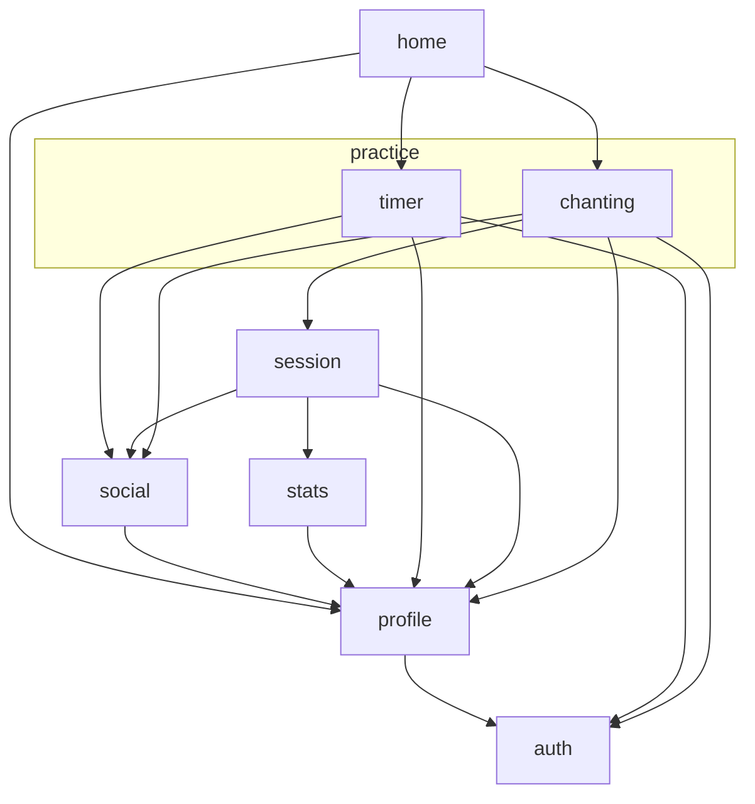
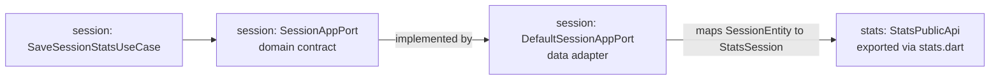

# Module Dependency Guidelines

This document defines import and dependency rules for the feature module packages under `packages/modules`. For module structure and development, see the [module development guidelines](./module_development_guidelines.md).

## Goal

Keep modules cohesive, testable, and easy to evolve by avoiding unnecessary or circular cross-module dependencies and coupling to implementation details.

## How to read this guide

| Category | Meaning | How to use it |
|---|---|---|
| **Target rules** | The boundaries described by the dependency policy and layer guidance. | Follow them for new and changed code. |
| **Current dependencies** | The feature dependencies declared in package manifests today. | Use the graph to understand existing paths and avoid cycles; a declared dependency is not necessarily a recommended pattern. |
| **Legacy deviations** | Existing code that does not yet meet a target rule. | Do not copy it as a pattern or add new violations; address it when migration is in scope. |

## Rule of thumb

1. Domain defines what is needed.
2. Data implements how it is done.
3. Presentation depends on domain contracts, not data implementations.
4. Cross-module imports use the dependency's package barrel only.

## Current module roots

- `packages/core/` (shared foundation, depends on no feature module)
- `packages/modules/app_events`
- `packages/modules/auth`
- `packages/modules/donate`
- `packages/modules/home`
- `packages/modules/practice/chanting`
- `packages/modules/session`
- `packages/modules/practice/timer`
- `packages/modules/profile`
- `packages/modules/social`
- `packages/modules/stats`

Feature modules are separate packages. Their internal structure is described in the [module development guidelines](./module_development_guidelines.md#package-structure).

## Direct feature-module dependencies

This graph shows direct dependencies declared in the feature package manifests. An arrow points from a dependent package to the package it depends on. Shared dependencies such as `core`, `firebase_provider`, and `assets`, as well as third-party packages, are omitted.



The `practice` box groups packages by folder; it is not itself a package. In this feature-to-feature graph, `auth` is the lowest-level feature dependency. `donate` and `app_events` currently have no declared dependencies on other feature packages.

## Layering inside a module

Presentation depends on domain contracts, and data implements them. For layer responsibilities and package layout, see the [module development guidelines](./module_development_guidelines.md#layers).

## Cross-module dependency policy

A module may depend on another module through its public API. Before adding a dependency, review the graph and existing dependency paths, consider the direction and responsibility of the relationship, and avoid circular dependencies. Do not add a dependency merely because another module exposes a convenient type or implementation.

Allowed:

1. Import from another module's package barrel (for example `package:profile/profile.dart`), using its public API, including deliberately exported reusable UI.
2. Import from `core` shared abstractions.
3. In a domain port, import another module's package barrel only when the port needs a stable public contract type.

Not allowed:

1. Import from another module's `domain`, `presentation`, or `data` path under `src/`.
2. Import private/internal files from another module.
3. Depend on another module's internal Cubits, screens, or widgets.

## Example: session consumes stats

When a completed session is logged, the session module asks the stats module to record statistics. The arrow shows the runtime call path for that operation:



1. The session [package manifest](../packages/modules/session/pubspec.yaml) declares a dependency on `stats`.
2. [SaveSessionStatsUseCase](../packages/modules/session/lib/src/domain/usecase/save_session_stats_use_case.dart) calls [SessionAppPort](../packages/modules/session/lib/src/domain/service/session_app_port.dart), a contract owned by the session domain.
3. [DefaultSessionAppPort](../packages/modules/session/lib/src/data/service/default_session_app_port.dart) implements the port. It imports `package:stats/stats.dart`, maps the session's internal `SessionEntity` to the public `StatsSession` model, and calls `StatsPublicApi.logSessionStats`.
4. The stats [barrel](../packages/modules/stats/lib/stats.dart) exports `StatsPublicApi` and `StatsSession`; the session [DI setup](../packages/modules/session/lib/src/session_di.dart) connects the port, adapter, public API, and use case.

The existing port also handles profile and health operations; the example focuses on its stats operation. This port-and-adapter approach isolates domain orchestration from another module's implementation. Not every cross-module interaction needs a port: presentation can consume a deliberately exported public widget directly.

## Where should a contract live?

Choose the owner by responsibility and dependency direction, not by the number of consumers.

| Need | Preferred location | Example |
|---|---|---|
| An operation or model belongs to a feature and other modules need it. | The owning feature's public API, exported through its barrel. Keep its internal entities and implementations private. | `StatsPublicApi` and `StatsSession` belong to `stats`. |
| A feature's domain needs an external capability for its own workflow. | A port in the consuming feature's domain, implemented by an adapter in its data layer. The adapter can use another feature's public API. | `SessionAppPort` belongs to `session`; `DefaultSessionAppPort` calls `StatsPublicApi`. |
| A capability or concept is foundational, stable, and independent of any feature. | `core`, provided its contract and types do not make `core` depend on a feature. | `HapticsService` is a shared device-capability contract. |

Before moving or creating a contract in `core`, ask:

1. Is it genuinely feature-independent, or is it named and shaped around one feature's workflow?
2. Can its contract and all referenced types remain independent of feature packages?
3. Would a feature-owned public API or a consumer-owned port express the relationship more clearly?
4. Is the resulting dependency direction appropriate and free of cycles?

Reuse alone is not enough to make a contract foundational. Do not move a feature-specific repository, model, or API into `core` merely because multiple modules use it or to hide a circular dependency. Reconsider ownership or introduce a narrow port and appropriate composition instead; then verify the resulting package graph remains acyclic.

## Profile model in insights: recommended approach

If an insights feature needs profile data, use one of these patterns.

1. Shared contract pattern:
   Consume a stable profile model exposed from the profile package's public barrel. If multiple modules need the same foundational contract, consider placing it in `core` only when it is genuinely feature-independent.
2. Local read-model pattern:
   Define an insights-specific read model with only required fields and map from the public profile model at the module boundary.

Use the smallest dependency that satisfies the use case.

## Public API files

Each module should expose public entrypoints and keep internals private.

Example public API files:

1. `packages/modules/profile/lib/profile.dart` (`package:profile/profile.dart`)
2. `packages/modules/stats/lib/stats.dart` (`package:stats/stats.dart`)
3. `packages/modules/practice/timer/lib/timer.dart` (`package:timer/timer.dart`)
4. `packages/modules/social/lib/social.dart` (`package:social/social.dart`)

Other modules should import only these barrel files, never `package:<module>/src/...`. Direct cross-package imports of `src/domain` contracts are not allowed; publish an intentional public contract through the barrel instead.

## Import examples

Good:

```dart
import 'package:profile/profile.dart';
import 'package:core/core.dart';
```

Bad:

```dart
import 'package:profile/src/presentation/view/profile_view.dart';
import 'package:profile/src/data/datasource/firebase_profile_data_provider.dart';
import 'package:profile/src/presentation/viewmodel/profile_edit_cubit.dart';
```

## Rules for repositories and data providers

1. Repositories in a module may use only their own module data providers.
2. No module may import another module's data provider directly.
3. Shared generic providers (for example Firestore CRUD base classes) belong in `core` or shared infrastructure, not in a feature module.

## Rules for presentation

1. Presentation can depend on:
   - its own module's bloc/cubit/use-cases
   - stable public contracts imported from another module's barrel
   - public UI deliberately exported by another module's barrel
   - core shared UI/utilities
2. Presentation cannot depend on another module's internal bloc/cubit/widgets/screens.

## Foreign models in presentation

Presentation may use a model from another module, but not by default and not freely.

Allowed:

1. The model is a stable business contract shared across modules.
2. The model is imported through the owning module's public barrel.
3. The widget genuinely needs the full model semantics, not just a few display fields.

Prefer mapping instead when:

1. The widget only needs a subset of fields.
2. The foreign model is shaped around another module's use case.
3. The UI would become tightly coupled to another module's future changes.

Recommended pattern:

1. Keep cross-module models at module boundaries.
2. Map them into local presentation models or view models before rendering.
3. Let leaf widgets consume local UI-focused models whenever practical.

### Example: acceptable usage

An insights widget can render a public `Session` model imported from the session package's barrel if the model is a stable contract and the widget genuinely needs its full semantics.

### Example: better local mapping

If an insights widget only needs:

1. session duration
2. completion time
3. session type

then prefer an insights-local presentation model such as `SessionSummaryViewData` instead of binding the widget directly to the full foreign `Session` entity.

## Migration guardrails

1. Run boundary checks for affected modules and distinguish pre-existing findings from new ones. Fix violations introduced by the change and report existing findings separately.
2. Do not introduce cross-module `src/` imports; use a public contract or port instead. If a temporary exception is genuinely necessary, agree on its scope and migration plan before introducing it, and record the reason and follow-up in the relevant issue or change.
3. Update dependency wiring in one place after each phase (composition root/DI).

## PR review checklist

1. Does any import reach into another package's `src/` folder?
2. Are cross-module imports using package barrels and public contracts only?
3. Did a domain file import UI or infrastructure details?
4. Are mappings done at module boundaries instead of leaking foreign models deeply?
5. Are contracts owned by the appropriate feature or by `core` only when foundational?
6. Are presentation widgets depending on foreign public models only when those models are stable contracts?
7. Is a new dependency justified, acyclic, and reflected in the graph?

## Automated checks

The written rules describe the target; automated checks cover only part of it:

1. Run `bash support/maintenance_scripts/check_module_boundaries.sh [module_dir...]` from the workspace root. It checks specific import and export patterns for domain isolation, cross-package `src/` access, data-to-presentation dependencies, public entity leaks, and internal layer exports.
2. The `packages/stepstones_lints` analyzer plugin mirrors domain checks for editor feedback but is not enabled yet.

A passing script does not prove full compliance: it does not determine whether a dependency is justified, detect every violation, or verify the entire dependency graph. Review those aspects separately, including circular dependencies.
