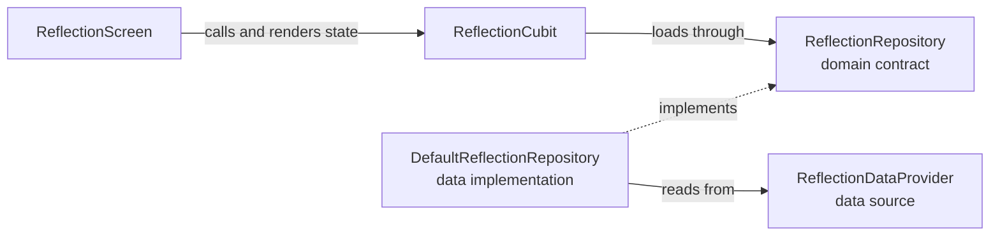

# Module Development Guidelines

This guide describes how to structure, implement, and integrate feature modules in the Stepstones workspace. For the current module graph and cross-module dependency rules, see the [module dependency guidelines](./module_dependency_guidelines.md).

## Goals

- Keep each feature cohesive, with clear responsibilities and a small public surface.
- Separate UI, business rules, and data access.
- Use the smallest structure that fits the feature; not every module needs every layer, route, or use case.

## Development workflow

Follow these steps for a new module; for an existing module, apply the steps relevant to the change:

1. **Define the boundary.** Identify the feature's responsibilities, consumers, and required behavior. Check the [dependency graph and contract-ownership guidance](./module_dependency_guidelines.md#where-should-a-contract-live) before choosing dependencies; avoid cycles and unnecessary coupling.
2. **Create or update the package.** Choose the module path and dependencies, add a new package to the workspace, and create only the parts of the [package structure](#package-structure) needed by the feature.
3. **Define contracts.** Decide what the module owns, what it exposes through its public API, and which domain repository or port contracts its behavior needs.
4. **Implement and test the behavior.** Add domain rules and use cases where meaningful, data providers and adapters for external capabilities, and presentation state and UI as needed. Test each layer's behavior as it is built.
5. **Expose the public surface.** Export only intended public contracts, models, UI, and integration entry points from the package barrel; keep implementation details internal.
6. **Wire the module.** Register dependencies and, when applicable, connect the module to the app's package dependencies, DI, routes, localization delegates, and Widgetbook. Use the [new-module checklist](#adding-a-module-to-the-workspace) for the applicable integration points.
7. **Generate and verify.** Regenerate changed generated sources, then format, analyze, test, and check boundaries. Analyze affected dependents and the app when contracts or composition change; see [code generation](#code-generation) and [testing and verification](#testing-and-verification).

## Layers

- **Domain:** Feature entities, repository and service contracts, and business rules. Use cases express meaningful operations or orchestration; a Cubit may use a repository contract directly for simple CRUD.
- **Data:** Data providers, repository implementations, platform integrations, and mappers. Data implementations fulfill domain contracts.
- **Presentation:** Screens and widgets render state and dispatch user actions. Cubits or Blocs coordinate flows and emit immutable state.
- **Public API:** Contracts, public models, reusable views, and selected view models intended for other packages. Export the intended surface from the package barrel.

Presentation depends on domain contracts; data implements domain contracts. Keep business logic and data access out of widgets.

## Package structure

Feature modules are workspace packages under `packages/modules/`. Practice modules are under `packages/modules/practice/`. Use an existing package such as `packages/modules/profile` as a reference and create only the files and folders needed.

```text
packages/modules/<feature>/
  pubspec.yaml
  analysis_options.yaml
  l10n.yaml                         # when localized UI is present
  lib/
    <feature>.dart                  # public barrel
    l10n/
      <feature>_en.arb
      <feature>_hu.arb
      <feature>_localizations.dart  # generated
    src/
      <feature>_di.dart
      <feature>_routes.dart         # when the module owns routes
      domain/
        entity/
        repository/
        port/
        service/
        usecase/
      data/
        datasource/
        repository/
        mapper/
        service/
      presentation/
        view/
        viewmodel/
      public/
        api/
        model/
        view/
        viewmodel/
  test/
```

`src/public/` identifies candidates for cross-module use; only items exported by `lib/<feature>.dart` are part of the public package API. Internal domain, data, and presentation files are not cross-module APIs. Do not hand-edit `*.g.dart`, `*.freezed.dart`, generated routes, or generated localizations.

## Worked example: a simple reflection screen

This hypothetical feature displays a reflection loaded from a data source. It illustrates the structure for a simple read-only flow; it is not an existing module or a requirement to add one. Assume no other feature needs its data or UI.

```text
packages/modules/reflection/
  lib/
    reflection.dart                        # barrel: DI, routes, localizations
    l10n/
      reflection_en.arb
      reflection_hu.arb
    src/
      reflection_di.dart                   # registers dependencies
      reflection_routes.dart               # route for the screen
      domain/
        entity/reflection_entity.dart      # reflection data used within module
        repository/reflection_repository.dart  # read contract
      data/
        datasource/reflection_data_provider.dart
        repository/default_reflection_repository.dart
      presentation/
        view/reflection_screen.dart
        viewmodel/reflection_cubit.dart     # loading, loaded, error states
  test/
    data/
    presentation/
```

The flow and dependency direction are:



At runtime, DI supplies the repository implementation to the Cubit; the screen asks the Cubit to load, and the Cubit calls the repository contract. The repository obtains and maps data from its provider, then the Cubit emits loaded or error state for the screen. The Cubit does not import the data implementation. A separate use case is unnecessary for this simple read; add one if meaningful business rules or orchestration emerge.

For this example:

1. Register the provider, repository, and Cubit in `reflection_di.dart`; expose DI and routes through the barrel. Keep the screen, repository, and entity internal unless another package genuinely needs them.
2. Add the package to the workspace and app, register its dependencies, add its routes, and register its localization delegate. Keep loading and error messages in both ARB files.
3. Test repository mapping and provider failures with a fake provider. Test Cubit loading, loaded, and error states with a fake repository, and widget rendering for those states.
4. Generate routes and localizations as applicable, then run the checks in [testing and verification](#testing-and-verification), including the app analysis for the integration changes.

## Public API and module relationships

Export only the contracts, public models, reusable views, view models, routes, localization delegates, and registration functions that consumers need. Map internal entities and persistence models to public models when data crosses a package boundary.

Modules can depend on other modules through their public barrels, including deliberately exported UI. Check the existing dependency graph and avoid circular dependencies before adding a package dependency. See the [module dependency guidelines](./module_dependency_guidelines.md) for the rules and current relationships.

## Dependency injection and routing

- Keep module registrations in `lib/src/<feature>_di.dart` and export the registration function through the barrel.
- Prefer constructor injection; register dependencies with lifetimes appropriate to their use. Cubits bound to a screen commonly use factories.
- Keep business logic out of DI files. The mobile app registers modules in `apps/mobile_app/lib/bootstrap/app_di.dart`.
- Define routes in `lib/src/<feature>_routes.dart` only when the module owns routes. Add them to the app router in `apps/mobile_app/lib/bootstrap/initializer.dart`.
- Add the module's localization delegate to `apps/mobile_app/lib/app.dart` when it has generated localizations.

## State and errors

- Use Cubit for straightforward state flows and Bloc when event-driven coordination is useful.
- Keep states focused and immutable, with explicit loading and failure states where needed.
- Handle errors where they can be reported or presented; use the project's logging and Crashlytics services where appropriate.

## Code generation

Run generation from the affected package directory before analysis and tests when changing annotated sources, such as Freezed models/states, JSON serialization, or generated GoRouter routes:

```bash
dart run build_runner build --delete-conflicting-outputs
```

After changing ARB files or localization configuration, run:

```bash
flutter gen-l10n
```

Both commands update generated Dart files; do not edit those files manually. Review the generated changes along with their sources. If workspace-wide generation is needed, run `melos run codegen` or `melos run codegen:l10n` from the repository root.

## Localization

For a module with user-facing text:

1. Put strings in `lib/l10n/<feature>_en.arb` and `lib/l10n/<feature>_hu.arb`. Keep keys consistent between locales and provide a Hungarian translation for each new string.
2. Configure `l10n.yaml` in the package root with the ARB directory, English template, output file, and feature-specific output class. See [profile's configuration](../packages/modules/profile/l10n.yaml) for an example.
3. Use generated accessors such as `ProfileLocalizations.of(context).profile` in widgets. Check the module and `core` localizations before adding duplicate strings. Use ICU plural/select syntax and placeholders for variable messages rather than constructing translated sentences in code.
4. Run `flutter gen-l10n` in the package after ARB or configuration changes. Export the generated localization class through the module barrel and add its delegate to the app when the app consumes the module.
5. Test relevant localized UI, including variable and plural messages when applicable. Do not hardcode user-facing text in widgets.

## Testing and verification

Add tests alongside the feature, using the smallest scope that covers its behavior:

- **Domain:** Unit-test meaningful use cases and business rules, including failure paths, with repository/port fakes or mocks.
- **Data:** Test repository behavior and mapping, including relevant errors and edge cases. Isolate Firebase and other SDKs behind providers or fakes.
- **Presentation:** Test Cubit/Bloc state transitions and widget rendering and interactions, including loading and error states where relevant.
- **Public API:** Test mapping or orchestration at the public boundary where it adds behavior.
- **Integration:** Test important flows spanning packages or platform services when lower-level tests are insufficient. App integration tests live in `apps/mobile_app/integration_test/`; see [commands](./commands.md) for running them and their flavor and environment requirements.

Organize tests under the package's `test/` directory, generally mirroring the source area. Run a focused test while iterating, for example from `packages/modules/practice/timer/`:

```bash
flutter test test/domain/start_timer_use_case_test.dart
```

Before completing a change, run the applicable generators, then format, analyze, and test each affected package from its directory:

```bash
dart format --line-length 120 lib test
flutter analyze
flutter test
```

Run the boundary check from the repository root with the actual module path. For example:

```bash
bash support/maintenance_scripts/check_module_boundaries.sh packages/modules/practice/timer
```

Distinguish pre-existing boundary findings from new ones and do not introduce new violations. When a public API, barrel, or core contract changes, analyze affected dependent packages and `apps/mobile_app`; also analyze the app when its composition changes. Record any checks not run and why. See [verify-package](../ai/skills/verify-package/SKILL.md) and the [dependency guidelines](./module_dependency_guidelines.md#automated-checks) for details and checker limitations.

## Adding a module to the workspace

- [ ] Confirm the feature boundary and its place in the dependency graph; avoid cycles.
- [ ] Create the package and add its path to the root `pubspec.yaml` workspace.
- [ ] Create its public barrel and add the package dependency to `apps/mobile_app/pubspec.yaml` if the app uses it.
- [ ] Register dependencies in `apps/mobile_app/lib/bootstrap/app_di.dart` when the app composes the module.
- [ ] Add routes and a localization delegate to the app when applicable.
- [ ] Add Widgetbook integration if its UI should be documented there.
- [ ] Update the module inventory in `AGENTS.md`.
- [ ] Generate code as needed, then format, analyze, test, and check boundaries.
