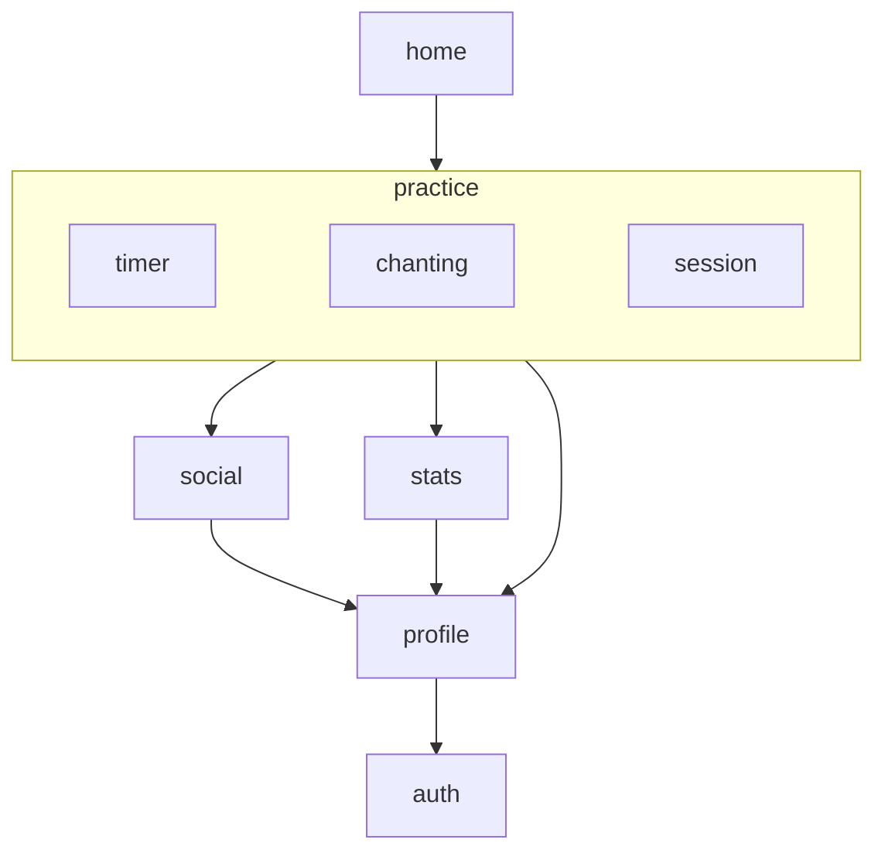
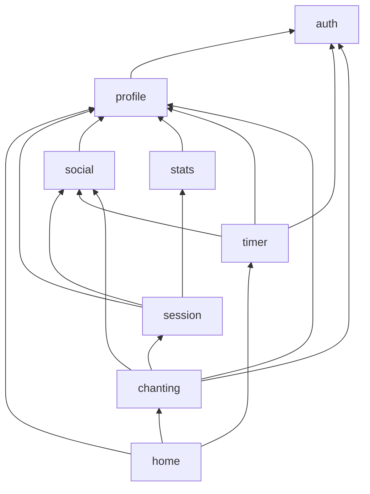

# Module Dependency Guidelines

This document defines import and dependency rules for the feature module packages under `packages/modules`.

## Goal

Keep modules independent, testable, and easy to evolve by preventing deep cross-module coupling.

## Rule of thumb

1. Domain defines what is needed.
2. Data implements how it is done.
3. Presentation depends on domain contracts, not data implementations.
4. Cross-module imports use the dependency's package barrel only.

## Current module roots

- `packages/core/` (shared foundation, depends on no feature module)
- `packages/modules/app_events`
- `packages/modules/auth`
- `packages/modules/donate`
- `packages/modules/home`
- `packages/modules/practice/chanting`
- `packages/modules/practice/session`
- `packages/modules/practice/timer`
- `packages/modules/profile`
- `packages/modules/social`
- `packages/modules/stats`

Each module is its own package with layers under `lib/src/` (`domain/`, `data/`, `presentation/`, `public/`).

## Direct feature-module dependencies

This graph shows direct dependencies declared in the feature package manifests. An arrow points from a dependent package to the package it depends on. Shared dependencies such as `core`, `firebase_provider`, and `assets`, as well as third-party packages, are omitted.






In this feature-to-feature graph, `auth` is the lowest-level feature dependency. `donate` and `app_events` currently have no declared dependencies on other feature packages.

## Layering inside a module

Allowed direction:

1. `presentation -> domain`
2. `presentation -> application` (if present)
3. `application -> domain`
4. `data -> domain`
5. `data -> core infrastructure`

Disallowed direction:

1. `domain -> presentation`
2. `domain -> data`
3. `presentation -> another module's data`
4. `presentation -> another module's presentation`

## Cross-module dependency policy

A module may depend on another module only through stable contracts.

Allowed:

1. Import from another module's package barrel (for example `package:profile/profile.dart`), using only its public API.
2. Import from `core` shared abstractions.
3. In a domain port, import another module's package barrel only when the port needs a stable public contract type.

Not allowed:

1. Import from another module's `domain`, `presentation`, or `data` path under `src/`.
2. Import private/internal files from another module.
3. Depend on another module's Cubits, screens, or implementation widgets.

## Profile model in insights: recommended approach

If an insights feature needs profile data, use one of these patterns.

1. Shared contract pattern:
   Consume a stable profile model exposed from the profile package's public barrel. If multiple modules need the same foundational contract, consider placing it in `core` only when it is genuinely feature-independent.
2. Local read-model pattern:
   Define an insights-specific read model with only required fields and map from the public profile model at the module boundary.

Use the smallest dependency that satisfies the use case.

## Public API files

Each module should expose public entrypoints and keep internals private.

Example public API files:

1. `packages/modules/profile/lib/profile.dart` (`package:profile/profile.dart`)
2. `packages/modules/stats/lib/stats.dart` (`package:stats/stats.dart`)
3. `packages/modules/practice/timer/lib/timer.dart` (`package:timer/timer.dart`)
4. `packages/modules/social/lib/social.dart` (`package:social/social.dart`)

Other modules should import only these barrel files, never `package:<module>/src/...`. Direct cross-package imports of `src/domain` contracts are not allowed; publish an intentional public contract through the barrel instead.

## Import examples

Good:

```dart
import 'package:profile/profile.dart';
import 'package:core/core.dart';
```

Bad:

```dart
import 'package:profile/src/presentation/view/profile_view.dart';
import 'package:profile/src/data/datasource/firebase_profile_data_provider.dart';
import 'package:profile/src/presentation/viewmodel/profile_edit_cubit.dart';
```

## Rules for repositories and data providers

1. Repositories in a module may use only their own module data providers.
2. No module may import another module's data provider directly.
3. Shared generic providers (for example Firestore CRUD base classes) belong in `core` or shared infrastructure, not in a feature module.

## Rules for presentation

1. Presentation can depend on:
   - its own module's bloc/cubit/use-cases
   - stable public contracts imported from another module's barrel
   - core shared UI/utilities
2. Presentation cannot depend on another module's bloc/cubit/widgets/screens.

## Foreign models in presentation

Presentation may use a model from another module, but not by default and not freely.

Allowed:

1. The model is a stable business contract shared across modules.
2. The model is imported through the owning module's public barrel.
3. The widget genuinely needs the full model semantics, not just a few display fields.

Prefer mapping instead when:

1. The widget only needs a subset of fields.
2. The foreign model is shaped around another module's use case.
3. The UI would become tightly coupled to another module's future changes.

Recommended pattern:

1. Keep cross-module models at module boundaries.
2. Map them into local presentation models or view models before rendering.
3. Let leaf widgets consume local UI-focused models whenever practical.

### Example: acceptable usage

An insights widget can render a public `Session` model imported from the session package's barrel if the model is a stable contract and the widget genuinely needs its full semantics.

### Example: better local mapping

If an insights widget only needs:

1. session duration
2. completion time
3. session type

then prefer an insights-local presentation model such as `SessionSummaryViewData` instead of binding the widget directly to the full foreign `Session` entity.

### When to place a model in `core`

Move a model into `core` only when:

1. It is used by multiple modules as the same core business concept.
2. It is stable and not shaped around one module's private workflow.
3. It is foundational and can live in `core` without making `core` depend on a feature.

Otherwise, keep the domain model in its owning module and expose a separate public contract if consumers need it.

## Migration guardrails

1. Do not introduce temporary cross-module `src/` imports during migration; use a public contract or port instead.
2. Do not move route/bootstrap internals into feature modules until module contracts are stable.
3. Update dependency wiring in one place after each phase (composition root/DI).

## PR review checklist

1. Does any import reach into another package's `src/` folder?
2. Are cross-module imports using package barrels and public contracts only?
3. Did a domain file import UI or infrastructure details?
4. Are mappings done at module boundaries instead of leaking foreign models deeply?
5. Are shared abstractions placed in core/shared rather than in a feature module?
6. Are presentation widgets depending on foreign public models only when those models are stable contracts?

## Automation

Boundary checks are automated via:

1. Local script: `bash support/maintenance_scripts/check_module_boundaries.sh [module_dir...]` (source of truth, also used by agents through `ai/skills/verify-package`).
2. Analyzer plugin: `packages/stepstones_lints` mirrors the domain checks for editor feedback (not enabled yet).

The script fails when a module imports another package's `src/` files, a domain file imports
platform packages, Flutter UI or another feature module outside a port, data imports presentation,
the public API exposes entities, or a barrel exports internal layers.
